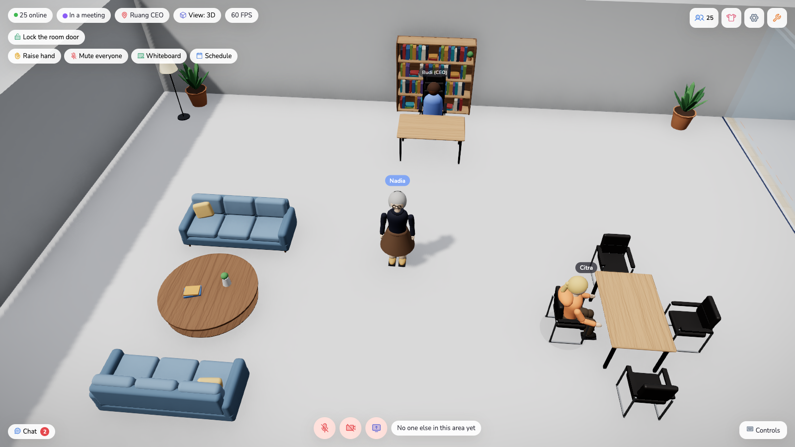
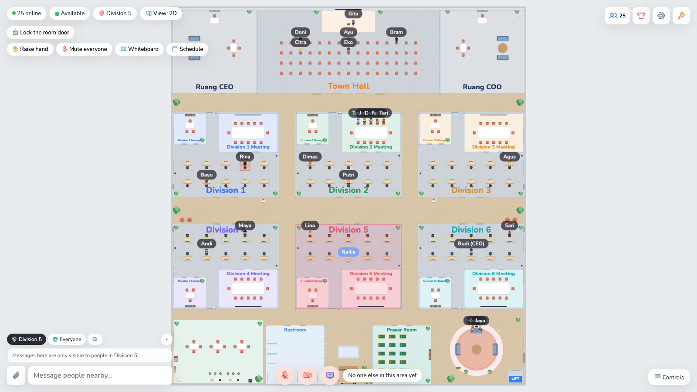
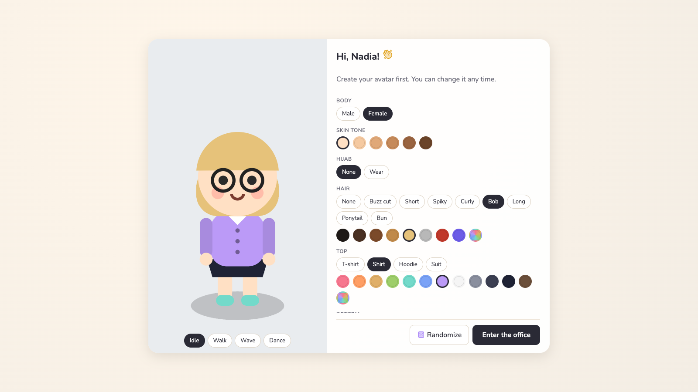

# Virtual Office

A 2D/3D virtual office in the browser, in the spirit of Gather and ZEP — walk around as a customizable avatar,
talk to whoever is near you, drop into rooms for private meetings, and gather everyone for an all-hands on stage.
Built and load-tested for up to 100 people online at once (the server's cap).


| | |
|---|---|
|  |  |
| **Town hall stage** on the 1st floor: whoever is on stage is heard by the whole floor; the screen shows a website or screen share. | **Meeting rooms**: shared whiteboard, raised hands, booking schedule, lockable door. |
|  |  |
| **Zoom in** for a third-person view; zoom out for the bird's-eye view. | **Members & presence**: status, floor and area of everyone; DMs, locate, follow, summon. |
|  |  |
| **Avatar editor**: body, skin tone, hair or hijab, outfit, colors, glasses, hats — semi-realistic proportions and face in 3D. | **Executive offices**: high-back leather executive chair, sofa corner and leather guest chairs for managers and C-level. |
|  |  |
| **2D view** (default): the light top-down office; zoomed all the way out the whole floor fits on screen. | **2D avatar preview**: in the 2D view the editor shows the 2D avatar, turning through all four directions. |

The UI is available in **English and Indonesian** (switch on the sign-in screen or in Settings).

## Features

**Look** — colour-coded duotone icons (Phosphor) and the Nunito typeface, bundled with the app (no external font/CDN calls).
The 3D view is **semi-realistic** without downloading any 3D models: furniture is built in code from bevelled and
rounded shapes with a wood-grain texture (office chairs on five-star casters, desks with metal frames and monitors,
cushioned sofas, leafy plants, ping-pong, billiards and foosball tables), and avatars have human proportions with eyes,
brows, nose and lips. Managers' and C-level offices get **executive chairs** (high-back padded leather on a chrome base
— black for C-level, cognac for managers) and leather guest chairs; this is derived from the floor plan, so edited
layouts keep it.

**Two views** — a light, illustrated **2D** top-down view (default; plain Canvas 2D, no WebGL download) and the full
**3D** view (Three.js + Rapier, loaded only when picked). Switch any time with the **View** pill or in Settings —
position, chat and calls stay as they are. Both views share the same game logic and collision sizes. The avatar
editor previews the avatar in whichever view is active (a turning 2D figure, or a rotatable 3D model).

**Help & first-run tour** — new accounts (and guests) get a short skippable tour the first time they enter, spotlighting
movement, audio, chat, desks, rooms and floors; it's remembered per account, not per device. The **?** button opens a
full guide that adapts to the active view (2D/3D) and to touch devices, and can replay the tour. Every action button
has a tooltip explaining what it does.

**Spatial audio & video (LiveKit)**
- **Areas** — rooms (glass walls + door), open areas (lounge, pantry, rooftop) and every desk. Everyone in the same
  area is connected at full volume; people outside can't listen in.
- **Proximity** outside areas — 4 m hearing radius (drawn on the floor), full volume within 2 m.
- **Stage** — anyone standing on a stage is heard by the whole floor (except people inside closed rooms). Ideal for all-hands.
- Video bubbles above avatars; area-scoped **screen sharing**, shown on the room's presentation screen.
- Pick microphone / camera / speaker, **noise suppression** (with echo cancellation & auto gain), **push-to-talk** (hold Space).

**Office life**
- **Multiple floors** connected by an elevator; the default office has the workspace with a town hall on the 1st floor
  and a game arcade on the 2nd floor.
- **Arcade** — walk up to an arcade machine and press **F** to play Snake (shared leaderboard), or sit at a table for
  a two-player game of Connect Four that anyone nearby can watch.
- **Desks** — claim a desk and lock it (🔒 focus mode) so nobody can walk in.
- **Doors** — open/close with **F**; people inside can lock the door, people outside can only knock.
- **Room booking** — schedule a room; the current/next booking shows above its door.
- **Screens** — put a website (slides, dashboards, Figma…) on a room's screen for everyone in the room.
- **Meetings** — raise hand, mute everyone, shared whiteboard (also shown on the wall).
- Sit on chairs and sofas (**C**), emotes, **follow** someone (auto-walk behind them, even across floors).

**Communication & presence**
- Chat tabs: **Area** (only people who can hear you), **Everyone**, and **direct messages**.
- **Attachments** (paste, drag & drop or 📎; images inline, max 5 MB), **emoji reactions**, **message search**, `@username` mentions.
- Member list with automatic status — available, in a meeting (in a room, on stage or from your calendar), focus, away — or set it manually.
- **Summon** someone to you, or jump to them. Sound + desktop notifications, unread count in the tab title.
- **Calendar** — paste your secret iCal link (e.g. Google Calendar) to show "in a meeting" automatically.

**Accounts & admin**
- Username/password accounts (scrypt), 30-day sessions, one active connection per account, auto-reconnect.
- Change your password; admins can reset anyone's password (one-time temporary password).
- **Guest links** — time-limited invite links for visitors without an account (no desks, no bookings; auto-removed on expiry).
- The **first registered account becomes admin**. Admins can require an invite code, change roles, kick or disable
  accounts, and **edit the floor plan in-app**: drag furniture, **R** rotate, **Del** delete, add/resize rooms, areas,
  stages and floors — changes are saved and pushed to everyone live.
- Data is stored in `server/data/db.json` and **backed up automatically** (on start and every 6 hours, last 20 kept in `server/data/backups/`).

**Performance** — no shadows at all in 3D (no shadow map, no blob shadows, no ambient occlusion); remote avatars switch
to a low-detail model beyond ~14 m; the directory is throttled to once per second. Positions are sent per viewer by
distance: people within 15 m 15×/s, farther people on the same floor 5×/s, other floors 1×/s (with short numeric ids),
and remote avatars interpolate at the pace their updates arrive. Measured with 50 simulated users walking around (before the detailed furniture below): **855 draw calls / 54k triangles per
frame** (down from 3,671 / 748k), **~27 KB/s** downstream per client, and ~5% CPU on the server. An automatic
low-quality mode kicks in when the frame rate drops. Touch joystick on mobile. The 2D view loads ~280 KB (gzip)
instead of ~1.5 MB and draws the static floor plan once into a cached layer, redrawing only avatars and live items
each frame.

**Load test, 100 people** (99 bots walking non-stop, all crowded around the spawn area, plus one real browser on an
Apple M1): game server ~5–11% of one core and ~85 MB RAM; **~37 KB/s** downstream per client (~3.7 MB/s out of the
server for 100 people, before audio/video; idle people send nothing, so real offices use far less); 2D and 3D (high
quality) both at **~60 FPS** with 99 avatars in view; the 101st person is turned away. LiveKit, same config as
`docker-compose.yml`: a town hall with 4 publishers (2 cameras + 2 mics) and 96 listeners delivered all 384 tracks
with 0% packet loss (~25 Mbit/s out, ~260 kbit/s per listener); 100 open mics at once also held; participant 101 is
refused by LiveKit (`room.max_participants`).

The detailed 3D furniture stays cheap: static pieces are merged per material into a few meshes, slender parts get
plain boxes instead of bevels, and segment counts scale with size. Once merged, the thousands of hidden source pieces are skipped by the per-frame
matrix update (it cost ~2–3 ms per pass while walking). Walking through the busy workspace on an Apple M1 runs at
~58–60 FPS, on par with the old box furniture, for ~10 KB more download (gzip).

## Controls

| Key | Action |
|---|---|
| WASD / arrows | Walk (relative to camera) · **Shift** to run |
| Drag / Q·E · scroll | 3D: rotate camera · zoom (close = third-person, far = top-down) |
| Scroll · pinch | 2D: zoom (W always walks up the screen); zoomed all the way out the whole floor fits on screen |
| C · F | Sit / stand · open, close or knock on a door, or play an arcade game |
| Space | Push-to-talk (when enabled) |
| 1 · 2 · 3 | Wave · thumbs up · dance |
| M · V · Enter | Mic · camera · chat |
| ? (top right) | Help — full guide and replay the tour |

## Getting started

```bash
brew install livekit   # once — local audio/video server
bun install
bun run dev            # LiveKit (dev mode) + game server + client
```

Open http://localhost:5173 and register — the first account becomes admin. Requires [Bun](https://bun.sh) ≥ 1.3 — it's the package manager, the server runtime (TypeScript runs directly, no
build step), the test runner, and it runs Vite.

To use LiveKit Cloud instead of the local dev server, copy `server/.env.example` to `server/.env` and fill in
your credentials. **Always set real LiveKit credentials when deploying** — without them the server falls back to
LiveKit's public dev keys.

## Deploying with Dokploy

`docker-compose.yml` runs two services: **app** (game server that also serves the built web client) and **livekit**
(audio/video). Dokploy's Traefik provides the domains and HTTPS.

1. **DNS** — point three subdomains at the server's public IP, e.g. `office.example.com`, `livekit.example.com` and
   `turn.example.com`.
2. **Firewall** — open **UDP 7882**, **TCP 7881** and **UDP 3478** (TURN) to the internet (audio/video goes straight to the server, not
   through Traefik). On a cloud VPS open them in the provider's firewall / security group too, not only `ufw`.
   If these are closed, people can sign in but won't hear or see each other.
3. **Dokploy** — create a *Compose* service from this repo. In **Environment**, set the variables from
   [`.env.example`](.env.example) (`LIVEKIT_DOMAIN`, `TURN_DOMAIN`, `LIVEKIT_API_KEY`, `LIVEKIT_API_SECRET`; generate the key
   and secret as described there).
4. **Domains** — add `office.example.com` → service `app`, port `2567`, and `livekit.example.com` → service
   `livekit`, port `7880`, both with HTTPS (Let's Encrypt). If your Dokploy version doesn't attach Compose services to
   its network automatically, add the external `dokploy-network` to both services. Don't add `turn.example.com` here:
   the `livekit` service's Traefik labels already route it (TCP, TLS on 443, certificate from Let's Encrypt), so
   `livekit` must be on `dokploy-network` for TURN/TLS to work.
5. Deploy, open `https://office.example.com` and register — the first account becomes admin.

Data (accounts, chat, uploads, backups) lives in the `office-data` volume (`/data` in the container), so it survives
redeploys. The app refuses to start in production without real LiveKit credentials.

Behind Traefik the server reads the client IP from `X-Forwarded-For` (`TRUST_PROXY=1`) for sign-in rate limits:
5 failed attempts per username per 15 minutes; per-IP limits are generous because a whole office may share one IP.

**NAT relay (TURN)** — LiveKit's built-in TURN server is enabled, so no separate coturn is needed. Most people connect
directly (UDP 7882, falling back to TCP 7881); when that fails — symmetric NAT, or networks that block everything but
port 443 (some corporate or hotel Wi-Fi) — media is relayed through TURN: **TURN/UDP on 3478** straight to the server,
and **TURN/TLS on 443** through Traefik (`turn.example.com`, TLS terminated by Traefik and forwarded to LiveKit's
port 5349). Relayed traffic flows through your server, so it costs bandwidth.

**Capacity** — up to **100 people** online at once (`MAX_PLAYERS` in `server/src/index.ts`, matching
`room.max_participants` in `docker-compose.yml`); the 101st sees "office is full". Change both together.

**Production preview locally**: `bun run build`, start `livekit-server` with real keys, then run
`NODE_ENV=production LIVEKIT_URL=ws://localhost:7880 LIVEKIT_API_KEY=… LIVEKIT_API_SECRET=… bun run --cwd server start`
and open http://localhost:2567.

## Tests

```bash
bun run test           # unit + integration: area/stage rules, calendar parsing, server protocol, translations
bun run test:e2e       # real browser (needs Chrome/Chromium, or set CHROME_PATH)
```

- `shared/layout.test.ts` — floor plan, areas, stage, doors, seats, elevators, validation.
- `server/src/server.test.ts` — starts a real server and checks auth, invite codes, area-scoped chat, DMs, door locks,
  whiteboard privacy, floors & stage, passwords, guest links, bookings, uploads, reactions, search, screens, and the
  first-run tour flag, and distance-tiered position updates.
- `server/src/ratelimit.test.ts` — sign-in attempt limiter.
- `server/src/migrate.test.ts` — one-time data migrations (older saved floor plans get the default decorations once).
- `client/src/controller.test.ts` — shared avatar logic (input, sitting, doors, focus desks, zones, position sync).
- `client/src/motion2d.test.ts` — 2D collision: walls, doors, furniture, sliding, starting inside an obstacle.
- `client/src/world2d/*.test.ts` — 2D drawing, layer sizing (stays under the iOS canvas limit), labels, pinch zoom,
  zoom-out that fits the whole floor (camera centres on the building), editor hit-testing.
- `client/src/chairStyle.test.ts` — executive & guest chairs only in managers' / C-level offices.
- `client/src/i18n.test.ts` — every UI string has an English translation.
- `e2e/smoke.test.ts` — two users sign up, chat, take the elevator, go on stage and switch 2D ↔ 3D in a real browser
  (`bun run test:e2e` runs it in 2D, `bun run test:e2e:3d` in 3D).

## Project layout

```
client/   Vite + React + Zustand + LiveKit client; 2D view (Canvas 2D, client/src/world2d/) and lazy-loaded
          3D view (React Three Fiber + Rapier); shared avatar logic in client/src/controller.ts;
          3D furniture in client/src/Furniture.tsx (shape primitives in shapes3d.tsx), avatars in avatar/Character.tsx
server/   Bun + ws (game state, chat, accounts, files) + LiveKit tokens; data in server/data/
shared/   Floor-plan model, area/stage rules & furniture collider sizes, used by both server and client
e2e/      Browser end-to-end tests
```

## Roadmap

- TURN over TLS for networks that only allow port 443
- Google sign-in, Slack integration
