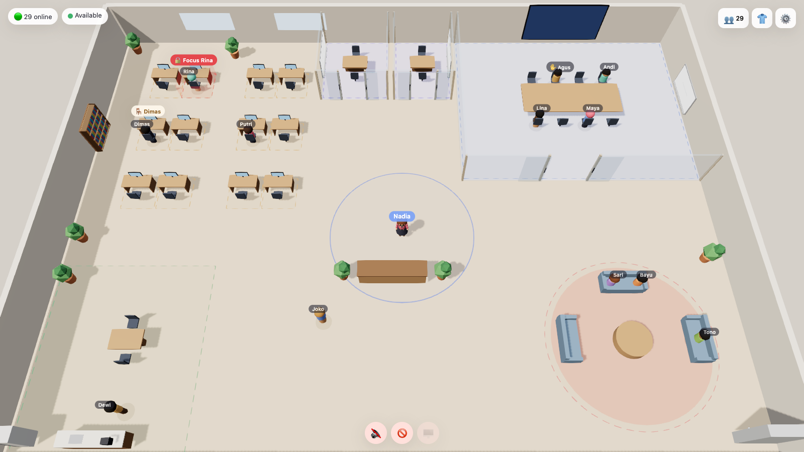
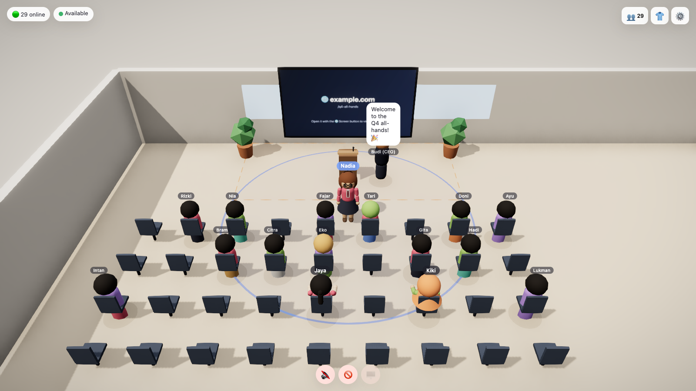
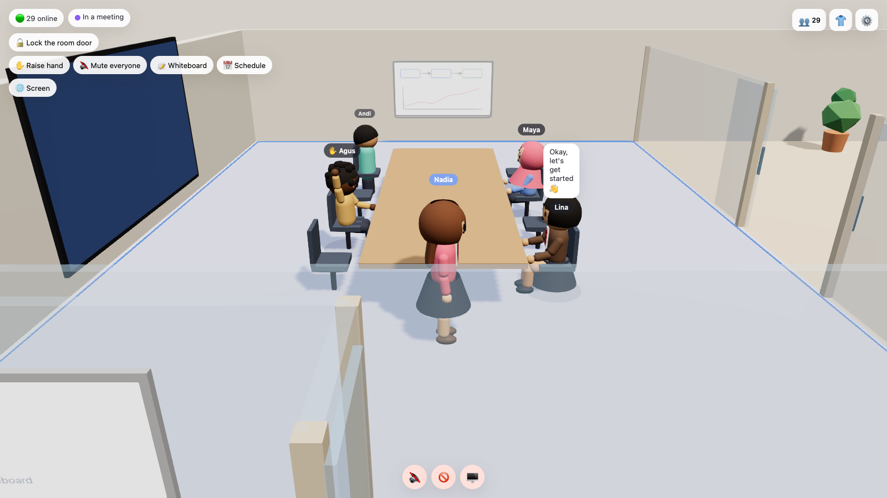
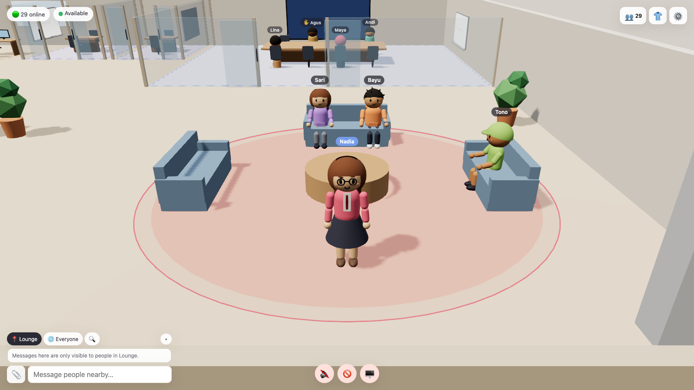
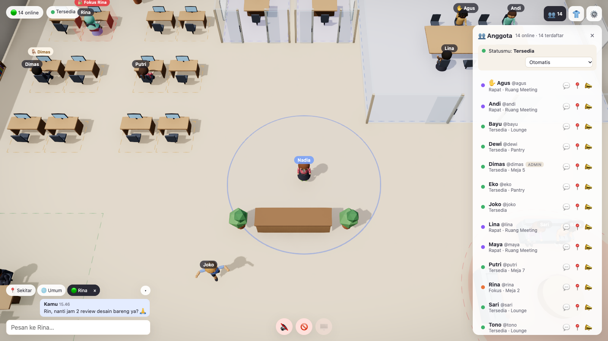
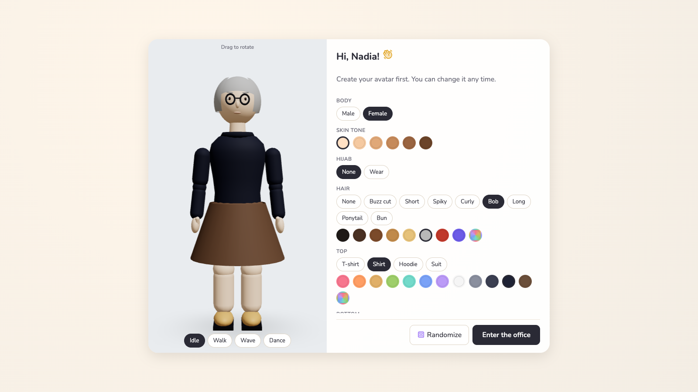

# Virtual Office

A 3D virtual office in the browser, in the spirit of Gather and ZEP — walk around as a customizable avatar,
talk to whoever is near you, drop into rooms for private meetings, and gather everyone for an all-hands on stage.
Built and load-tested for teams of ~50 people.



| | |
|---|---|
|  |  |
| **Town hall stage** on the 1st floor: whoever is on stage is heard by the whole floor; the screen shows a website or screen share. | **Meeting rooms**: shared whiteboard, raised hands, booking schedule, lockable door. |
|  |  |
| **Zoom in** for a third-person view; zoom out for the bird's-eye view. | **Members & presence**: status, floor and area of everyone; DMs, locate, follow, summon. |
|  | |
| **Avatar editor**: body, skin tone, hair or hijab, outfit, colors, glasses, hats. | |

The UI is available in **English and Indonesian** (switch on the sign-in screen or in Settings).

## Features

**Spatial audio & video (LiveKit)**
- **Areas** — rooms (glass walls + door), open areas (lounge, pantry, rooftop) and every desk. Everyone in the same
  area is connected at full volume; people outside can't listen in.
- **Proximity** outside areas — 4 m hearing radius (drawn on the floor), full volume within 2 m.
- **Stage** — anyone standing on a stage is heard by the whole floor (except people inside closed rooms). Ideal for all-hands.
- Video bubbles above avatars; area-scoped **screen sharing**, shown on the room's presentation screen.
- Pick microphone / camera / speaker, **noise suppression** (with echo cancellation & auto gain), **push-to-talk** (hold Space).

**Office life**
- **Multiple floors** connected by an elevator; the default office has the workspace with a town hall on the 1st floor
  and a game arcade on the 2nd floor.
- **Arcade** — walk up to an arcade machine and press **F** to play Snake (shared leaderboard), or sit at a table for
  a two-player game of Connect Four that anyone nearby can watch.
- **Desks** — claim a desk and lock it (🔒 focus mode) so nobody can walk in.
- **Doors** — open/close with **F**; people inside can lock the door, people outside can only knock.
- **Room booking** — schedule a room; the current/next booking shows above its door.
- **Screens** — put a website (slides, dashboards, Figma…) on a room's screen for everyone in the room.
- **Meetings** — raise hand, mute everyone, shared whiteboard (also shown on the wall).
- Sit on chairs and sofas (**C**), emotes, **follow** someone (auto-walk behind them, even across floors).

**Communication & presence**
- Chat tabs: **Area** (only people who can hear you), **Everyone**, and **direct messages**.
- **Attachments** (paste, drag & drop or 📎; images inline, max 5 MB), **emoji reactions**, **message search**, `@username` mentions.
- Member list with automatic status — available, in a meeting (in a room, on stage or from your calendar), focus, away — or set it manually.
- **Summon** someone to you, or jump to them. Sound + desktop notifications, unread count in the tab title.
- **Calendar** — paste your secret iCal link (e.g. Google Calendar) to show "in a meeting" automatically.

**Accounts & admin**
- Username/password accounts (scrypt), 30-day sessions, one active connection per account, auto-reconnect.
- Change your password; admins can reset anyone's password (one-time temporary password).
- **Guest links** — time-limited invite links for visitors without an account (no desks, no bookings; auto-removed on expiry).
- The **first registered account becomes admin**. Admins can require an invite code, change roles, kick or disable
  accounts, and **edit the floor plan in-app**: drag furniture, **R** rotate, **Del** delete, add/resize rooms, areas,
  stages and floors — changes are saved and pushed to everyone live.
- Data is stored in `server/data/db.json` and **backed up automatically** (on start and every 6 hours, last 20 kept in `server/data/backups/`).

**Performance** — remote avatars use cheap blob shadows and switch to a low-detail model beyond ~14 m; the directory is
throttled to once per second. Measured with 50 simulated users walking around: **855 draw calls / 54k triangles per
frame** (down from 3,671 / 748k), **~27 KB/s** downstream per client, and ~5% CPU on the server. An automatic
low-quality mode kicks in when the frame rate drops. Touch joystick on mobile.

## Controls

| Key | Action |
|---|---|
| WASD / arrows | Walk (relative to camera) · **Shift** to run |
| Drag / Q·E · scroll | Rotate camera · zoom (close = third-person, far = top-down) |
| C · F | Sit / stand · open, close or knock on a door, or play an arcade game |
| Space | Push-to-talk (when enabled) |
| 1 · 2 · 3 | Wave · thumbs up · dance |
| M · V · Enter | Mic · camera · chat |

## Getting started

```bash
brew install livekit   # once — local audio/video server
npm install
npm run dev            # LiveKit (dev mode) + game server + client
```

Open http://localhost:5173 and register — the first account becomes admin. Requires Node ≥ 22 (Vite 8).

To use LiveKit Cloud instead of the local dev server, copy `server/.env.example` to `server/.env` and fill in
your credentials. **Always set real LiveKit credentials when deploying** — without them the server falls back to
LiveKit's public dev keys.

## Deploying with Dokploy

`docker-compose.yml` runs two services: **app** (game server that also serves the built web client) and **livekit**
(audio/video). Dokploy's Traefik provides the domains and HTTPS.

1. **DNS** — point two subdomains at the server's public IP, e.g. `office.example.com` and `livekit.example.com`.
2. **Firewall** — open **UDP 7882** and **TCP 7881** to the internet (audio/video goes straight to the server, not
   through Traefik). On a cloud VPS open them in the provider's firewall / security group too, not only `ufw`.
   If these are closed, people can sign in but won't hear or see each other.
3. **Dokploy** — create a *Compose* service from this repo. In **Environment**, set the variables from
   [`.env.example`](.env.example) (`LIVEKIT_DOMAIN`, `LIVEKIT_API_KEY`, `LIVEKIT_API_SECRET`; generate the key and
   secret as described there).
4. **Domains** — add `office.example.com` → service `app`, port `2567`, and `livekit.example.com` → service
   `livekit`, port `7880`, both with HTTPS (Let's Encrypt). If your Dokploy version doesn't attach Compose services to
   its network automatically, add the external `dokploy-network` to both services.
5. Deploy, open `https://office.example.com` and register — the first account becomes admin.

Data (accounts, chat, uploads, backups) lives in the `office-data` volume (`/data` in the container), so it survives
redeploys. The app refuses to start in production without real LiveKit credentials.

Behind Traefik the server reads the client IP from `X-Forwarded-For` (`TRUST_PROXY=1`) for sign-in rate limits:
5 failed attempts per username per 15 minutes; per-IP limits are generous because a whole office may share one IP.

Networks that allow nothing but port 443 (some corporate or hotel Wi-Fi) need TURN over TLS, which this setup doesn't
include yet.

**Production preview locally** (Node ≥ 22): `npm run build`, start `livekit-server` with real keys, then run
`NODE_ENV=production LIVEKIT_URL=ws://localhost:7880 LIVEKIT_API_KEY=… LIVEKIT_API_SECRET=… npm start -w server`
and open http://localhost:2567.

## Tests

```bash
npm test               # unit + integration: area/stage rules, calendar parsing, server protocol, translations
npm run test:e2e       # real browser (needs Chrome/Chromium, or set CHROME_PATH)
```

- `shared/layout.test.ts` — floor plan, areas, stage, doors, seats, elevators, validation.
- `server/src/server.test.ts` — starts a real server and checks auth, invite codes, area-scoped chat, DMs, door locks,
  whiteboard privacy, floors & stage, passwords, guest links, bookings, uploads, reactions, search, screens.
- `server/src/ratelimit.test.ts` — sign-in attempt limiter.
- `client/src/i18n.test.ts` — every UI string has an English translation.
- `e2e/smoke.test.ts` — two users sign up, chat, take the elevator and go on stage in a real browser.

## Project layout

```
client/   Vite + React + React Three Fiber + Rapier + Zustand + LiveKit client
server/   Node + ws (game state, chat, accounts, files) + LiveKit tokens; data in server/data/
shared/   Floor-plan model & area/stage rules, used by both server and client
e2e/      Browser end-to-end tests
```

## Roadmap

- TURN over TLS for networks that only allow port 443
- Google sign-in, Slack integration
